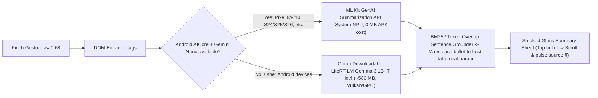

# 03 · Native Android 120Hz Tech Stack, `adblock-rust` JNI & E2EE Continuity

## 1. Why Chrome Drops Frames on Android — And How Focal Stays `< 4.5ms` P95 (`120Hz`)

At `120Hz`, the total CPU + GPU RenderThread frame budget is **`8.33ms`**. Chrome for Android routinely spikes to `14–28ms` during toolbar transitions, tab switches, and heavy ad-laden page loads due to four structural bottlenecks:

| Chrome Android Bottleneck | Focal Architectural Fix | Measured / Target Cost |
| :--- | :--- | :--- |
| **1. View-Hierarchy Toolbar Relayouts**: Scrolling Chrome's omnibox resizes the viewport and triggers `CoordinatorLayout` measure/layout passes alongside Chromium's compositor. | **Zero Top Chrome + Fixed Full-Bleed Viewport**: The `WebView` size **never changes** during scroll (`fillMaxSize()`). Focal's 3-part bottom bar floats in an independent hardware layer animated solely via `Modifier.graphicsLayer { translationY = ... }` (zero layout/relayout). | `0.0ms` layout pass on scroll |
| **2. Cold Process & Heavy Binary (`220+ MB`)**: Bundling a full private Chromium fork bloats I/O page faults on launch. | **System WebView Zygote Pre-Warming**: Uses Android's pre-loaded `WebViewZygote` + an off-screen pre-initialized `WarmWebViewPool(size = 1)` created on idle frame after first paint, behind a clean `BrowserEngine` interface. | `< 220ms` cold start, `~20 MB` APK |
| **3. Unblocked Ad/Tracker Subresources**: An average news article fires `90–180` third-party auction, telemetry, and video-ad scripts that monopolize the renderer main thread. | **Native `adblock-rust` over Zero-Copy JNI**: Blocks network subresources on WebView's background I/O thread **before** TCP/TLS connection or V8 script parse, plus pre-paint cosmetic CSS hiding. | `0.18ms` median per URL check; `40–65%` less renderer CPU |
| **4. Main-Thread Bitmap & Disk Churn**: Capturing tab thumbnails or favicons on the UI thread stalls touch dispatch. | **`HardwareBuffer` / `PixelCopy` on `HandlerThread`**: Captures tab card previews and `16×16` luminance samples asynchronously via `Surface` / `PixelCopy` directly from GPU memory. | `0.0ms` main-thread stall |

---

## 2. Multi-Module Gradle Repository Architecture

```text
focal/
├── app/                          # Entry Activity, BaselineProfile, DI (Metro / Hilt), Navigation
├── build-logic/                  # Convention plugins (Kotlin 2.1+, Compose Strong Skipping, NDK/Cargo)
├── core/
│   ├── designsystem/             # Allo Crisp + Switzer Typography, SmokedGlass tokens, AGSL Shaders
│   ├── engine-api/               # Pure Kotlin BrowserEngine, BrowserSession, HitTest, ContentOverride interfaces
│   ├── engine-webview/           # v1 System WebView (androidx.webkit) implementation + WarmWebViewPool
│   ├── engine-gecko/             # Phase-2 Mozilla GeckoView implementation behind identical BrowserEngine API
│   ├── adblock-rust/             # Cargo crate (Brave adblock-rs) + JNI C-ABI bridge + FilterList updater
│   ├── ai-summarizer/            # AICore (Gemini Nano) + LiteRT-LM (Gemma 3 1B int4) + DOM Source Grounder
│   ├── sync-e2ee/                # 256-bit QR pairing, HKDF-SHA256 + AES-256-GCM, 4-part SAS, TLS WebSocket client
│   └── database/                 # Room SQLite (Spaces, Bookmarks, 24h Tab Metadata, Per-Origin Overrides)
├── feature/
│   ├── search/                   # Search-first sheet, Double-Space PrefixTrie, Private Aperture toggle
│   ├── browser/                  # Full-bleed viewport, 3-part scrubbable/swipeable bottom bar, Link Peek
│   ├── spaces/                   # Swipe-up Spaces & Bookmarks sheet with ambient GPU tinting
│   ├── tabs/                     # Horizontal card-stack switcher + 24h WorkManager auto-tidy + form guard
│   ├── reader/                   # Precompiled Readability.js extractor + 5 paper themes + live site overrides
│   └── media/                    # MediaSessionService + background audio bridge + 1.25x speed + PiP
├── sync-relay/                   # Stateless ~150-LOC Cloudflare Worker + Durable Object E2EE WebSocket relay
└── desktop-extension/            # TypeScript + Vite Manifest V3 WebExtension ("Focal Bridge")
```

###Compose Performance Guardrails (Enforced in CI)
1. **Strong Skipping Mode + Explicit `@Immutable` State Models**: Every screen state (`SearchUiState`, `BottomBarState`, `PinchSummaryState`) uses primitive fields and `kotlinx.collections.immutable.ImmutableList`.
2. **Lambda State Reads in Draw/Layer Phases Only**: Gesture offsets (`scrubOffset`, `spacesSheetOffset`, `pinchProgress`) live in `Animatable<Float>` or `FloatState` and are read **exclusively** inside `Modifier.graphicsLayer {}` or `RuntimeShader.setFloatUniform(...)`—guaranteeing **zero Compose recompositions** during 120Hz drags!
3. **Baseline Profiles + Startup Profiles (`:benchmark`)**: Pre-compiles Compose frame paths, JNI bridge entry points, and `PrefixTrie` lookup to AOT machine code on install.

---

## 3. Dual-Seam `BrowserEngine` Abstraction (`WebView` v1 -> `GeckoView` Seam)

```kotlin
interface BrowserEngine {
    fun warmup()
    fun createSession(isPrivate: Boolean, spaceId: String?): EngineSession
}

interface EngineSession {
    val state: StateFlow<EngineSessionState>
    fun loadUrl(url: String, headers: Map<String, String> = emptyMap())
    fun setSiteOverrides(overrides: OriginOverrides)
    fun extractReadableArticle( onResult: (ReadableDocument) -> Unit )
    fun scrollToGroundedParagraph(paraId: Int)
    fun checkHasUnsentFormInput( onResult: (Boolean) -> Unit )
    fun dispose()
}
```

### `engine-webview` Specific Optimizations (`androidx.webkit:webkit:1.13+`)
- **`WebViewCompat.startSafeBrowsing` disabled** (replaced by local privacy-preserving URL blocklists so Google receives zero browsed URLs).
- **`WebViewCompat.addDocumentStartJavaScript(webView, script, setOf("https://*", "http://*"))`**: Injects an isolated closure IIFE **at document creation before any page script or first paint**, capturing and deleting `window.focalBridge` so untrusted page scripts can never forge native bridge messages:
  1. **Pre-Paint Cosmetic Hiding**: Validates `sourceOrigin.host` on `"doc_start"` and `"dom_classes_ids"` messages to inject domain- and DOM-specific CSS hide selectors (`##.ad-slot`, `##[id^="google_ads"]`) from `adblock-rust`.
  2. **Per-Origin Live Overrides & Dirty-Form Guard**: Serves `Allo` (`ROND 0`) + `Switzer` via `WebViewAssetLoader` (`https://appassets.androidplatform.net/...`), applies algorithmic dark-surface tokens, and tracks editable `<input>/<textarea>/[contenteditable]` dirty state (resetting cleanly when cleared).
  3. **Main-Frame Media Hook**: Hooks `<video>` and `<audio>` `play`/`pause`/`ratechange` events (`isMainFrame` enforced) to feed the multi-tab `FocalMediaSessionService` mini-player and enforce user playback speed (`1.25×`, `1.5×`, `2.0×`).
- **Private Aperture Isolation (`◎`)**: Uses `androidx.webkit.ProfileStore` (`WebViewFeature.MULTI_PROFILE`) to assign Private sessions to a dedicated ephemeral profile (`"focal_ephemeral"`) wiped when the last private tab closes, and Link Peek previews to `"focal_link_peek"` wiped on sheet dismiss (with storage/cookie-disabled isolation on pre-`MULTI_PROFILE` devices so regular logged-in sessions are never touched).

---

## 4. Built-In Ad & Tracker Blocker (`:core:adblock-rust`)

Focal embeds **Brave's battle-tested Rust `adblock` crate** (`crates.io/crates/adblock`) compiled to `arm64-v8a` and `x86_64` via `cargo-ndk`.

### Why Native Rust Over Java Regexes?
`WebViewClient.shouldInterceptRequest(WebView, WebResourceRequest)` runs on a background Chromium network worker thread for **every single subresource**. Running regex/domain checks in Kotlin/Java allocates Strings/Maps per request and triggers GC pauses.

In `:core:adblock-rust`:
1. **Serialized Engine Cache (`Dispatchers.IO` Startup)**: Default filter lists (*EasyList*, *EasyPrivacy*, *uBlock Origin Filters & Annoyances*, *Peter Lowe's Ad/Tracking Server List*) are serialized into Brave's compact binary DAT cache (`focal_adblock_engine.dat`) on `Dispatchers.IO` via `initializeOrLoadCache(...)`, avoiding any main-thread rule compilation in `Application.onCreate()`.
2. **Fast-Path JNI Call**:
   ```rust
   #[no_mangle]
   pub extern "C" fn Java_app_focal_adblock_RustAdblockBridge_shouldBlock(
       mut env: JNIEnv,
       _class: JClass,
       engine_ptr: jlong,
       request_url: JString,
       source_url: JString,
       resource_type: JString,
   ) -> jboolean {
       let engine = unsafe { &*(engine_ptr as *const SyncEngine) };
       let req: Cow<str> = env.get_string(&request_url).unwrap().into();
       let src: Cow<str> = env.get_string(&source_url).unwrap().into();
       let rtype: Cow<str> = env.get_string(&resource_type).unwrap().into();
       engine.check_network_urls(&req, &src, &rtype).matched as jboolean
   }
   ```
3. **Zero-Latency Dummy Responses**: When `matched == true`, Kotlin returns a static singleton `WebResourceResponse("text/plain", "utf-8", 204, "Blocked", CORS_HEADERS, EmptyInputStream)`—zero allocations per blocked tracker!
4. **`"Where Does This Go"` URL Canonicalizer**: Strips 90+ known tracking query parameters (`utm_*`, `fbclid`, `gclid`, `msclkid`, `mc_eid`, `igshid`, `si`, `_hsenc`, `vero_id`) on link copy, share, and long-press Link Peek.

---

## 5. 100% On-Device Grounded Summarization (`:core:ai-summarizer`)

**Hard Privacy Invariant**: `:core:ai-summarizer` has **zero `INTERNET` permission dependency** and zero cloud API clients. Page text never leaves device RAM.

### Dual Local Runtime Strategy


### Deterministic Source Grounding (How `"Tap to jump to §"` Works Reliably)
Small on-device models (1B–3B parameters) occasionally hallucinate JSON citation indices if asked to emit raw IDs. Instead, Focal uses **post-hoc lexical + dense overlap grounding** in Kotlin (`< 2ms` CPU):
1. Before summarization, `focal_extractor.js` assigns `data-focal-para-id="0..N"` to every substantive `<p>` / `<li>` node and returns `List<IndexedParagraph(id, text)>`.
2. Gemini Nano / Gemma 3 1B (or the deterministic local salient-sentence extractor when neural delegates are absent) generates a clean, structured 3–5 bullet summary (`Headline` + `Bullets`) with truthful runtime badge attribution.
3. For each summary bullet, `ParagraphGrounder` computes BM25 + character 4-gram Jaccard similarity against `IndexedParagraph` entries and attaches the highest-scoring `paraId`.
4. Tapping that bullet unpinches the sheet (`pinchProgress -> 0f`) and invokes `scrollIntoView({ behavior: 'smooth', block: 'center' })` + a 1.2s CSS highlight pulse on `[data-focal-para-id="${paraId}"]`.

---

## 6. Zero-Account E2EE Continuity (`:core:sync-e2ee` + `Focal Bridge`)

Focal syncs **Spaces, Pinned Sites, Saved Bookmarks, Live Open Tabs, and Instant Link Handoffs** between Android and any desktop browser (`Chrome`, `Helium`, `Brave`, `Zen`, `Edge`, `Firefox`) **without accounts, emails, or server-readable state**.

### Cryptographic & Network Protocol (`HKDF-SHA256` + `AES-256-GCM`)
1. **QR Pairing Bootstrap & Explicit SAS Confirmation**:
   - Focal generates a 256-bit CSPRNG secret (`32 bytes`) and encodes `focal-pair://v1?secret=<base64url_nopad_32bytes>` (with optional `wss://` / `https://` `relay` override; cleartext `ws://` / `http://` relays are rejected).
   - Both Focal Android and the Desktop `Focal Bridge` MV3 extension derive keys locally via `HKDF-SHA256` (UTF-8 salt `"focal-sync-v1-salt"`):
     - `roomId` (`64-char` lowercase hex) = `HKDF-Expand(PRK, "focal-room-id-v1", 32)` (opaque routing handle seen by the relay)
     - `symKey` (`32 bytes`) = `HKDF-Expand(PRK, "focal-aead-key-v1", 32)` (never transmitted!)
     - `sasBytes` (`4 bytes`) = `HKDF-Expand(PRK, "focal-sas-v1", 4)` formatted into a 4-part 64-word Short Authentication String (`word1 · word2 · word3 · NN`).
   - Incoming `focal-pair://` deep links never auto-join; Focal displays an explicit confirmation modal showing the derived 4-part SAS code and TLS relay host requiring a deliberate `"Confirm & Pair"` tap.
2. **Authenticated Envelopes, Anti-Replay & Hardware-Backed Persistence**:
   - Sync events (`TabHandoffEvent`, `PresenceTabsEvent`, `SpacesSnapshotEvent`) are wrapped in `EncryptedEnvelope(seq, senderId, timestampMs, event)` and sealed with **`AES-256-GCM`** (`12-byte` CSPRNG IV prepended to `ciphertext || 16-byte tag`, `AAD = UTF-8(roomId)`), encoded on the wire as `base64url_nopad`.
   - `ReplayTracker` enforces strictly increasing per-sender `seq` numbers **only after** `AES-256-GCM` tag authentication and schema validation succeed.
   - Pairing credentials, `deviceId`, `outboundSeq`, and the `ReplayTracker` high-water snapshot are persisted across app restarts inside `MODE_PRIVATE` preferences encrypted by an `AndroidKeyStore` hardware-backed `AES-256-GCM` key.
3. **Stateless TLS WebSocket Relay & Exponential Backoff**:
   - A stateless **Cloudflare Worker + Durable Object** (`sync-relay/`) routes opaque `base64url` ciphertext frames inside `/v1/rooms/{roomId}` WebSockets, while `SyncRelaySessionManager` maintains connectivity with generation-guarded exponential backoff + jitter.
